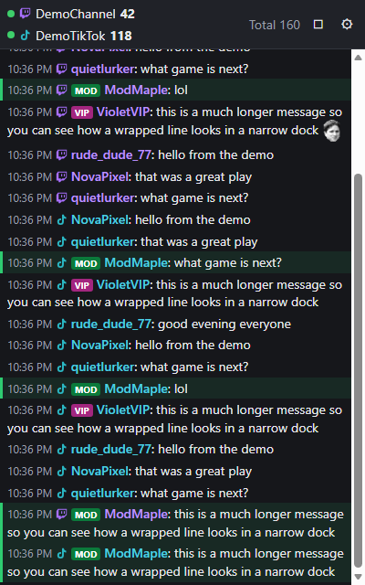
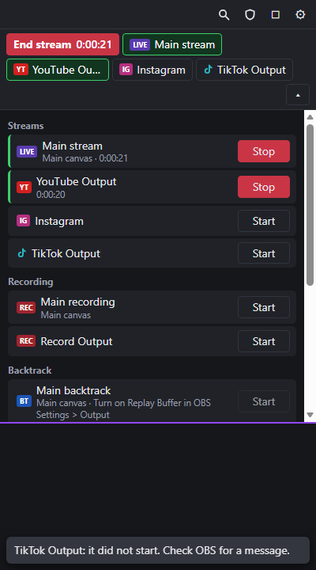
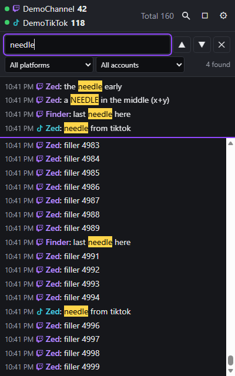

# Multi Chat Hub

A private chat dock for OBS. It runs inside OBS: no server, no extra app, no browser tab.

**Status: test build 0.4.0.** One Twitch channel (live chat, viewer count, moderation), Go Live buttons, a Moderator page, look settings, clean mode and chat search. Not yet tested inside OBS or with a live Twitch sign-in.

## Install

1. Close OBS.
2. Run `MultiChatHub-Setup-0.4.0.exe` from the Releases page and choose **Install**.
3. Open OBS. If the dock is not showing, tick **Docks > Multi Chat Hub**.

The installer copies the dock to `C:\ProgramData\obs-studio\plugins\MultiChatHub`, backs up OBS's settings, adds one entry to OBS's dock list and exits. Run it again to update or uninstall. It is not signed yet, so Windows may show a warning.

By hand instead: put this folder somewhere permanent, then in OBS open **Docks > Custom Browser Docks** and add the full path of `dock.html`, for example `file:///C:/MultiChatHub/dock.html`.

## Connect Twitch

1. Go to https://dev.twitch.tv/console/apps and choose **Register Your Application**.
2. OAuth Redirect URL: `http://localhost`. Category: any. **Client Type: Public.**
3. Copy the **Client ID**. There is no secret to copy.
4. In the dock, paste it and choose **Sign in to Twitch**. Enter the code at the Twitch page it shows.

To try the dock without signing in, turn on **Demo chat** in its settings.

## Using it

- Click a name, or right-click a message, for actions.
- Scroll up to pause chat. **Jump to latest** resumes.
- Dot colors: green connected, yellow reconnecting, red needs attention (hover for why).

## Go Live buttons

They sit under the viewer counts and control OBS itself: its own stream, recording, replay buffer and virtual camera, plus every output in Aitum Stream Suite if you use it.

1. In OBS, open **Tools > WebSocket Server Settings**, turn the server on and choose **Show Connect Info**.
2. Copy the **Server Password**. In the dock, open the gear, then **Go Live**, paste it and choose **Connect to OBS**.

- **Go Live** asks where. Only the main stream is ticked the first time, and your choice is remembered. The main stream starts first.
- Each button starts or ends one stream. The arrow opens every output, with clips, chapters, file splits and pause.
- Under the gear you can rename, hide or tag each output with its canvas.
- Adding outputs or changing stream keys is still done in OBS or Aitum. The dock never asks OBS for stream keys.

## Moderator page

The shield button opens every Twitch action the dock can do, with a tab per signed-in Twitch account. Choose which ones show under the gear, in **Moderator page**. Actions that only work while live, or that your sign-in does not allow, are greyed out with the reason. A few things Twitch keeps to its own site are links marked "Opens Twitch".

If you signed in before 0.4.0, sign out and in again once so Twitch allows the new actions.

## Look and clean mode

Open the gear for show/hide toggles, colors, saved themes, font and font size. Changes apply at once and are saved.

- **Keep text readable automatically** adjusts text and name colors to the background. Turn it off to use your exact colors.
- If a color picker does not open inside OBS, type the code (like `#1a2b3c`) beside it.
- The square button beside the gear turns on clean mode. The small corner square brings everything back, and turns yellow or red if a connection has trouble.
- Themes save colors only, not the font.

## Search

Click the magnifier, or press Ctrl+F with the dock focused (this also works in clean mode).

- Several words: all must appear, in any order. `"quoted text"`: exact phrase. `from:name`: username only.
- Filter by platform or account. The arrows, or Enter and Shift+Enter, move through matches.
- Click a result to see it in chat with the messages around it. **Jump to latest** returns to live chat.
- Click a name or right-click a result for moderation.

Search covers messages received since the dock opened (about the last 30,000). Closing OBS clears it.

## Where your sign-in is kept

On your PC, encrypted, inside OBS's own browser storage. The OBS WebSocket password is kept the same way. Neither is ever in this folder. This stops casual reading, not malware running as you. If the dock is unused for about 30 days, Twitch asks you to sign in again.

## Planned: TikTok (Stage 3)

TikTok will be **read-only**, on Euler Stream's free tier, with each streamer using their own free key. No TikTok login or cookies are used.

- Planned: chat, gifts, follows, viewer count, and pinned messages if they can be read.
- Greyed out with the reason shown: sending messages, pinning, bans, mutes, mod changes.
- The viewer list is marked "limited", because TikTok only exposes ranked viewers.

This is an unofficial service and can break when TikTok changes something.

## For developers

Plain HTML and JavaScript. Only the installer needs building: `installer\build.ps1` uses the compiler that comes with Windows. Run the tests with `node --test tests/*.test.js`.
