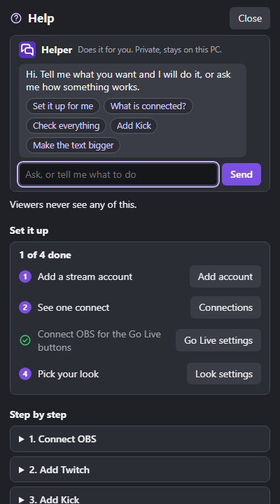
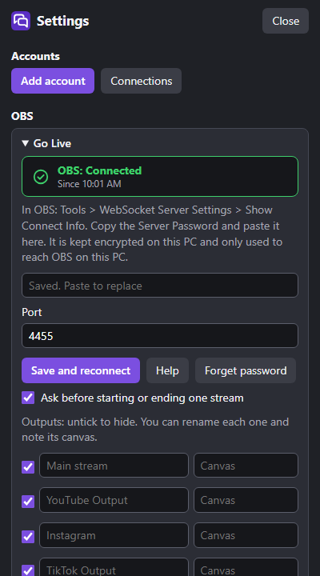
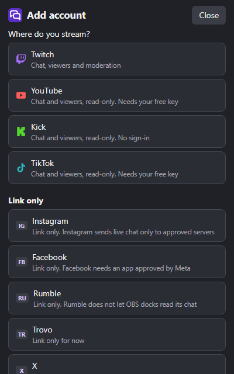
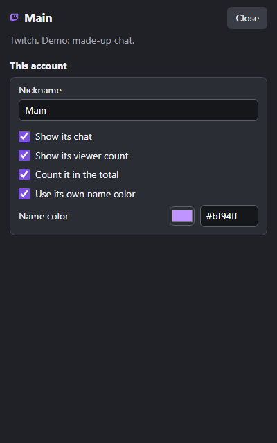
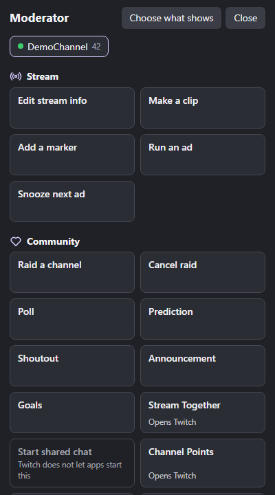

# Multi Chat Hub

A private chat dock for OBS. It runs inside OBS: no server, no extra app, no browser tab.

**Status: test build 0.7.0.** Several accounts at once (Twitch, Kick, YouTube, TikTok), Go Live buttons, a Moderator page, look settings, clean mode and chat search. Twitch sign-in and the automatic OBS connection work inside OBS. YouTube and TikTok have not been tried with a real key yet.

## Install

1. Close OBS.
2. Run `MultiChatHub-Setup-0.7.0.exe` from the Releases page and follow the steps.
3. Open OBS. If the dock is not showing, tick **Docks > Multi Chat Hub**.

The installer copies the dock to `C:\ProgramData\obs-studio\plugins\MultiChatHub`, backs up OBS's settings, adds one entry to OBS's dock list and exits. Run it again to update or uninstall. It is not signed yet, so Windows may show a warning.

By hand instead: put this folder somewhere permanent, then in OBS open **Docks > Custom Browser Docks** and add the full path of `dock.html`, for example `file:///C:/MultiChatHub/dock.html`.

## Help and the Helper

The **?** button at the top opens Help: a setup checklist that ticks itself, step-by-step guides with links, and how everything works.

At the top of it is the **Helper**. Type what you want, such as "set it up for me", "add kick somename", "hide tiktok chat", "make the text bigger" or "check everything", and it does it. It asks before anything goes live, bans or deletes. It is a list of rules, not an online AI, so it is free and nothing you type leaves your PC.

## Connection lights

OBS and every account have a live light: green check connected, yellow reconnecting, red needs you. If one drops for more than a moment, a bar at the top says when, even in clean mode. Click the **OBS** light for a page with every connection and what happened.

## Add your accounts

Choose **Add account** at the top of the dock. Each account gets its own box with its viewer count.

| Platform | What you get | What it needs |
|---|---|---|
| Twitch | Chat, viewers, moderation | Sign in (see below) |
| Kick | Chat and viewers, read-only | The channel name |
| YouTube | Chat and viewers, read-only | Your own free YouTube API key |
| TikTok | Chat and viewers, read-only | Your own free Euler Stream key |
| Instagram, Facebook, Rumble, Trovo, X, other | A box that opens the page | A name or link |

- The **chat bubble** on a box shows or hides that account's chat.
- Click a box for its own settings: nickname, on or off, chat, viewer count, total, name color, order and remove.
- Instagram sends live comments only to a web server with an app Meta approved, so a dock inside OBS cannot read them.
- Kick and TikTok use unofficial connections. They can stop working when those sites change something.
- YouTube's free daily limit lasts about 5.4 hours of chat at the normal pace. A slider in the account's settings slows it down to last longer.

### Twitch

1. Go to https://dev.twitch.tv/console/apps and choose **Register Your Application**.
2. OAuth Redirect URL: `http://localhost`. Category: any. **Client Type: Public.**
3. Copy the **Client ID**. There is no secret to copy.
4. In the dock choose **Add account > Twitch**, paste it and choose **Sign in to Twitch**. Enter the code at the Twitch page it shows.

To add a second Twitch account, log in to that account in your browser first.

To try the dock without signing in, turn on **Demo chat** in its settings.

## Using it

- Click a name, or right-click a message, for actions.
- Scroll up to pause chat. **Jump to latest** resumes.
- Dot colors: green connected, yellow reconnecting, red needs attention (hover for why).

## Go Live buttons

They sit under the viewer counts and control OBS itself: its own stream, recording, replay buffer and virtual camera, plus every output in Aitum Stream Suite if you use it.

**The installer connects them by itself.** Leave **Connect to OBS by itself** ticked and there is no password to copy. It turns on OBS's WebSocket server if it is off (after a backup) and keeps its password on. If you change that password later, run the installer again.

By hand instead:

1. In OBS, open **Tools > WebSocket Server Settings**, turn the server on and choose **Show Connect Info**.
2. Copy the **Server Password**. In the dock, open the gear, then **Go Live**, paste it and choose **Connect to OBS**.

- **Go Live** asks where. Only the main stream is ticked the first time, and your choice is remembered. The main stream starts first.
- Each button starts or ends one stream. The arrow opens every output, with clips, chapters, file splits and pause.
- Under the gear you can rename, hide or tag each output with its canvas.
- Adding outputs or changing stream keys is still done in OBS or Aitum. The dock never asks OBS for stream keys.

## Moderator page

The shield button opens every Twitch action the dock can do, with a tab per signed-in Twitch account. Choose which ones show under the gear, in **Moderator page**. Actions that only work while live, or that your sign-in does not allow, are greyed out with the reason. A few things Twitch keeps to its own site are links marked "Opens Twitch".

If you signed in before 0.4.0, sign out and in again once so Twitch allows the new actions.

## Look and clean mode

Open the gear for show/hide toggles, colors, saved themes, font and font size. Changes apply at once and are saved.

- **Keep text readable automatically** adjusts text and name colors to the background. Turn it off to use your exact colors.
- If a color picker does not open inside OBS, type the code (like `#1a2b3c`) beside it.
- The button beside the gear turns on clean mode. The small corner button brings everything back, and turns yellow or red if a connection has trouble.
- Themes save colors only, not the font.
- The boxes pick the biggest of four sizes that leaves most of the dock for chat.

## Search

Click the magnifier, or press Ctrl+F with the dock focused (this also works in clean mode).

- Several words: all must appear, in any order. `"quoted text"`: exact phrase. `from:name`: username only.
- Filter by platform or account. The arrows, or Enter and Shift+Enter, move through matches.
- Click a result to see it in chat with the messages around it. **Jump to latest** returns to live chat.
- Click a name or right-click a result for moderation.

Search covers messages received since the dock opened (about the last 30,000). Closing OBS clears it.

## Where your sign-in is kept

On your PC, encrypted, inside OBS's own browser storage. The OBS WebSocket password and your YouTube and TikTok keys are kept the same way. The installer's saved OBS connection is locked in `connect.js`, and the key that opens it is only in OBS's own settings, in your Windows user folder. Nothing readable is ever in this folder. This stops casual reading, not malware running as you. If the dock is unused for about 30 days, Twitch asks you to sign in again.

## For developers

Plain HTML and JavaScript. Only the installer needs building: `installer\build.ps1` uses the compiler that comes with Windows. Run the tests with `node --test tests/*.test.js`.
